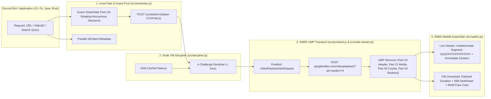

# ytdlm — Real-Time SABR UMP WebM/Opus Audio Streamer & Downloader

[](./LICENSE)
[](./package.json)

**`ytdlm`** is a zero-dependency core engine, `yt-dlp`-compatible CLI, and multi-language HTTP Streaming Gateway designed for **real-time on-the-fly WebM/Opus audio streaming (zero-wait live pipe)** and **100% seekable `.opus` file downloading** over the **SABR UMP (`Server-side ABR Unified Media Protocol`)** transport.

Built specifically for **multi-guild Discord music bots**, **24/7 Lo-Fi / Radio streams**, and cross-language media pipelines (`Node.js`, `Python`, `Java`, `Rust`, `Go`, `C#`).

---

## Table of Contents

1. [Why `ytdlm`?](#1-why-ytdlm)
2. [Deep-Dive Technical Architecture](#2-deep-dive-technical-architecture)
   - [2.1. SABR UMP Processing Pipeline](#21-sabr-ump-processing-pipeline)
   - [2.2. Strict Guest Session Isolation (`TV_GUEST_SABR_251`) vs. TV Premium (`TV_PREMIUM_SABR_774`)](#22-strict-guest-session-isolation-tv_guest_sabr_251-vs-tv-premium-tv_premium_sabr_774)
   - [2.3. Binary EBML/WebM Patching: Live Streaming vs. Seekable Download](#23-binary-ebmlwebm-patching-live-streaming-vs-seekable-download)
   - [2.4. Unlimited Multi-Stream Concurrency ($O(1)$ RAM) & 24/7 Continuous Playback](#24-unlimited-multi-stream-concurrency-o1-ram--247-continuous-playback)
3. [Project Structure](#3-project-structure)
4. [Installation & CLI Usage (`bin/ytdlm.js`)](#4-installation--cli-usage-binytdlmjs)
5. [Node.js API Reference (`src/index.js`)](#5-nodejs-api-reference-srcindexjs)
6. [HTTP Streaming & Metadata Gateway (`ytdlm serve`)](#6-http-streaming--metadata-gateway-ytdlm-serve)
7. [Multi-Language Discord Bot Integration Guides](#7-multi-language-discord-bot-integration-guides)
   - [7.1. JavaScript / TypeScript (`discord.js` v14 + `@discordjs/voice`) — Zero-FFmpeg](#71-javascript--typescript-discordjs-v14--discordjsvoice--zero-ffmpeg)
   - [7.2. Python (`discord.py` / `py-cord` / `nextcord`)](#72-python-discordpy--py-cord--nextcord)
   - [7.3. Java (`JDA` + `Lavaplayer` / `Lavalink`)](#73-java-jda--lavaplayer--lavalink)
   - [7.4. Rust (`Serenity` + `Songbird` / `Twilight`)](#74-rust-serenity--songbird--twilight)
   - [7.5. Go (`DiscordGo`) & C# (`Discord.Net` / `DSharpPlus`)](#75-go-discordgo--c-discordnet--dsharpplus)
8. [Testing & Verification](#8-testing--verification)
9. [Contributing](#9-contributing)
10. [License & Legal Disclaimer](#10-license--legal-disclaimer)

---

## 1. Why `ytdlm`?

| Feature | Traditional Downloaders | `ytdlm` (SABR UMP Live Engine) |
| :--- | :--- | :--- |
| **Time-to-First-Byte (Startup Latency)** | Waits for heavy process spawn or full file download (1.5s – 5s+) | **~270ms – 350ms** (emits patched WebM Init + first Opus Cluster immediately) |
| **Discord Bot CPU Overhead** | Decodes and re-encodes audio via FFmpeg | **0% Transcode CPU** (native 48kHz Stereo WebM/Opus frames piped directly to Discord) |
| **Memory Usage (Multi-Stream)** | Grows linearly with track length | **Constant $O(1)$ (~512 KB / stream)** via `retainClusters: false` + stream backpressure |
| **Account Safety (Anti-Ban)** | Risk of leaking cookies/tokens on standard `251` streams | **100% Isolated Anonymous Guest `TVHTML5`** with a rotating 16-session `visitorData` pool |
| **24/7 Continuous Streaming (10h+ mixes)** | Drops connection when CDN URL expires (`HTTP 403`) | **Auto-Healing SABR Session Refresh (`refreshSabrSession`)** resumes from exact millisecond |
| **Downloaded `.opus` Seekability** | Raw UMP dumps often show `00:00` or fail to seek | **Full binary patching of `Duration` + `56-byte SeekHead` + convergent multi-pass `Cues`** |

---

## 2. Deep-Dive Technical Architecture

### 2.1. SABR UMP Processing Pipeline



### 2.2. Strict Guest Session Isolation (`TV_GUEST_SABR_251`) vs. TV Premium (`TV_PREMIUM_SABR_774`)

In [`src/innertube.js`](./src/innertube.js):
1. **Standard `itag: 251` (Default) or `guest: true`**:
   - Fetches an anonymous Guest `visitorData` token from `https://www.youtube.com/sw.js_data` (`/(Cg[st][a-zA-Z0-9_-]+)/`).
   - Calls `/youtubei/v1/player` as `TVHTML5` with **zero cookies and zero `Authorization` headers**.
   - Selects the clean original audio track (excluding DRC dynamic range compression) at ~135–160kbps Opus (`48000 Hz`, 2 channels).
2. **Optional TV OAuth Token (`ytdlm auth login`) for `itag: 774` (`~256–300kbps Opus`)**:
   - Checks whether the requested video offers a high-bitrate `itag 774` stream.
   - **Strict Fallback Rule**: If a video does not have `itag 774`, `ytdlm` **discards the authenticated context** and resolves `itag 251` using an **Anonymous Guest session (`guest: true`)**. Main account tokens are never used to stream or download `itag 251`.

### 2.3. Binary EBML/WebM Patching: Live Streaming vs. Seekable Download

Raw UMP media payloads (`Part 21`) contain an unpatched WebM Initialization Segment (`Duration = 0` and a fixed Segment size) followed by fragmented `Cluster` chunks. [`src/webm.js`](./src/webm.js) handles two distinct modes:

* **Live Streaming Mode (`buildStreamingWebmInit`)**:
  - Patches `Segment -> Info -> Duration` (`0x4489`, 64-bit float) with the track's actual duration in milliseconds.
  - Rewrites the 12-byte `Segment` header (`0x18538067`) to the standard 8-byte EBML unknown/indeterminate streaming size:
    ```text
    18 53 80 67  01 FF FF FF FF FF FF FF
    ```
  - Downstream decoders (`@discordjs/voice`, `FFmpeg`, `Lavaplayer`, `GStreamer`, `MPV`) immediately recognize the stream as live WebM/Opus and decode incoming `Cluster` (`0x1F43B675`) frames on the fly.
* **Seekable File Download Mode (`buildSeekableWebmFile`)**:
  - Computes the exact total duration from the final assembled `Cluster`.
  - Injects a 56-byte `SeekHead` (`0x114D9B74`) pointing to `Info`, `Tracks`, and `Cues`.
  - Runs a convergent multi-pass loop (up to 5 passes) to build the `Cues` index table (`0x1C53BB6B`) mapping every `Cluster` timecode to its exact byte offset, producing a 100% seekable `.opus` file.

### 2.4. Unlimited Multi-Stream Concurrency ($O(1)$ RAM) & 24/7 Continuous Playback

1. **Constant $O(1)$ Memory per Active Stream (`retainClusters: false`)**:
   - In [`createSabrAudioStream`](./src/sabr-stream.js), `WebmClusterAssembler` runs with `retainClusters: false`.
   - As soon as a WebM `Cluster` is pushed to the Node.js `Readable` stream, its `Uint8Array` payload is immediately eligible for garbage collection.
   - Combined with native stream **backpressure (`highWaterMark: 512 KB`)**, `ytdlm` pauses SABR network polling whenever the consumer buffer is full and resumes only when Discord Voice reads more frames (~16–20 KB/s).
   - **Result**: Streaming to 100 concurrent Discord voice channels consumes only ~50 MB of RAM in total.
2. **16-Session Rotating Guest Pool**:
   - [`src/innertube.js`](./src/innertube.js) maintains a rotating pool of up to 16 independent anonymous `visitorData` tokens (`GUEST_POOL_MAX = 16`), distributing concurrent stream initialization across separate guest sessions.
3. **Auto-Healing SABR Session Refresh (`refreshSabrSession`)**:
   - During multi-hour streams or 24/7 radio playback, if a `googlevideo.com` URL expires (`HTTP 403`) or encounters transient network errors, `refreshSabrSession()` transparently resolves a fresh `serverAbrStreamingUrl`, deciphers the new `n` challenge, and resumes fetching clusters from `lastEmittedTc` without interrupting the output stream.
4. **Infinite 24/7 Loop (`loop: true`) & Continuous Multi-Track Queue (`streamContinuous`)**:
   - Pass `{ loop: true }` to `streamAudio()` (or `--loop` in CLI / `?loop=1` in HTTP) to loop a single stream 24/7.
   - Or use `streamContinuous(playlistOrAsyncFn, options)` to stream an infinite sequence of tracks back-to-back.

---

## 3. Project Structure

```text
ytdlm/
├── package.json                # Node.js package config (CommonJS + ESM + CLI binary)
├── LICENSE                     # Standard SPDX MIT License
├── DISCLAIMER.md               # Legal Disclaimer, Copyright Notice & Contributor Protection
├── README.md                   # Architecture & Multi-Language Integration Documentation
├── bin/
│   └── ytdlm.js                # yt-dlp compatible CLI (stream, download, info, search, serve, auth)
├── src/
│   ├── index.js                # CommonJS entrypoint
│   ├── index.mjs               # ES Module entrypoint
│   ├── protobuf.js             # Pure JS Protobuf wire encoder/decoder & SABR UMP demuxer
│   ├── webm.js                 # EBML/WebM parser, SeekHead/Cues builder & O(1) Cluster Assembler
│   ├── decipher.js             # Standalone Node.js VM base.js n-challenge decipher & disk cache
│   ├── innertube.js            # TVHTML5 Guest Pool (251), TV OAuth (774), Search & oEmbed
│   ├── sabr-stream.js          # Backpressure-aware Readable stream, auto-heal & file downloader
│   └── server.js               # HTTP Streaming & Metadata Gateway Server (/stream, /info, /search, /health)
├── sdks/
│   ├── javascript/
│   │   └── discord-js-bot.js   # Discord.js v14 + @discordjs/voice Multi-Guild & 24/7 Manager
│   ├── python/
│   │   ├── pyproject.toml      # PyPI package configuration
│   │   ├── ytdlm.py            # Python SDK (Subprocess Pipe + HTTP Gateway)
│   │   └── discord_py_bot.py   # Discord.py bot example using FFmpegOpusAudio(codec="copy")
│   ├── java/
│   │   ├── pom.xml             # Maven / JitPack build configuration
│   │   └── YtdlmClient.java    # Java 11+ SDK for JDA, Lavaplayer & Lavalink
│   └── rust/
│       ├── Cargo.toml          # Crates.io package configuration (ytdlm-rs)
│       └── src/lib.rs          # Rust SDK for Serenity / Songbird / Twilight
└── test/
    └── verify.js               # Automated verification suite (Metadata, Time-to-First-Byte, HTTP Server)
```

---

## 4. Installation & CLI Usage ([`bin/ytdlm.js`](./bin/ytdlm.js))

Requirements: **Node.js >= 18.0.0** (zero external npm dependencies).

```bash
npm install -g ytdlm
# Or from a local clone:
npm link
```

### CLI Command & Flag Reference

| Command / Flag | Description |
| :--- | :--- |
| `ytdlm stream <url_or_query>` | Stream live WebM/Opus audio to `stdout` (or to a file with `-o`). |
| `ytdlm <url_or_query> -o -` | `yt-dlp`-compatible drop-in syntax for piping live audio to `stdout`. |
| `ytdlm download <url> [-o path]` | Download a 100% seekable `.opus` file with patched `Duration`, `SeekHead` & `Cues`. |
| `ytdlm info <url> [-j]` | Print track and SABR format metadata as JSON (`yt-dlp -j` compatible). |
| `ytdlm search <query> [-n 5] [-j]` | Search videos in anonymous Guest mode. |
| `ytdlm serve [-p 8787] [--host 127.0.0.1]` | Start the HTTP Streaming & Metadata Gateway Server. |
| `ytdlm auth <login\|status\|logout>` | Manage optional TV OAuth device token (for `itag 774` HQ audio). |
| `-f, --format <251\|774\|bestaudio>` | Select format (`251`: Guest ~160kbps Opus; `774`: TV Premium ~256kbps Opus). |
| `--guest` | Force anonymous Guest `TVHTML5` mode (enabled by default for `251`). |
| `--start <ms>` | Start streaming immediately from the given millisecond offset (instant seek). |
| `--loop` | Loop the audio stream infinitely (24/7 mode). |
| `-q, --quiet` | Suppress progress/status logs on `stderr`. |

### CLI Examples (Using Creative Commons 3.0 Benchmark: Blender Foundation)

```bash
# 1. Pipe live WebM/Opus audio directly to ffplay or mpv (~300ms startup):
ytdlm stream "https://www.youtube.com/watch?v=aqz-KE-bpKQ" | ffplay -i pipe:0 -nodisp

# 2. Search and stream starting at 1:00 (--start 60000):
ytdlm stream "ytsearch:Big Buck Bunny Blender Foundation" -f 251 --start 60000 -q | mpv -

# 3. Continuous 24/7 infinite loop (--loop):
ytdlm stream "https://www.youtube.com/watch?v=aqz-KE-bpKQ" --guest --loop -q | ffmpeg -i pipe:0 -c:a copy -f ogg -

# 4. Download a 100% seekable .opus file into ./music:
ytdlm download "https://www.youtube.com/watch?v=aqz-KE-bpKQ" -o ./music/
```

---

## 5. Node.js API Reference ([`src/index.js`](./src/index.js))

```javascript
// CommonJS
const {
  Ytdlm,
  streamAudio,
  streamContinuous,
  downloadAudio,
  getInfo,
  searchVideos,
  startServer,
} = require('ytdlm');

// ES Modules (ESM)
import {
  streamAudio,
  streamContinuous,
  downloadAudio,
  getInfo,
  searchVideos,
  startServer,
} from 'ytdlm';
```

### 5.1. `streamAudio(videoIdOrQuery, options)`
Returns a backpressure-aware Node.js `Readable` stream emitting patched WebM Init + Opus Cluster chunks in real time.
- **`options`**:
  - `itag` (`number | string`, default: `251`): `251` (Guest Opus) or `774` (TV Premium HQ Opus).
  - `guest` (`boolean`, default: `true` for `251`): Force anonymous Guest session.
  - `startTimeMs` (`number`, default: `0`): Instant seek offset in milliseconds.
  - `loop` (`boolean`, default: `false`): Infinite 24/7 single-track loop.
  - `highWaterMark` (`number`, default: `524288` / 512 KB): Stream buffer threshold.
  - `onProgress` (`function({ bufferedMs, durationMs, percent, bytes, itag })`): Progress callback.
- **Methods & Events**:
  - `await stream.getInfo()`: Resolves with the track metadata object before the first media cluster is emitted.
  - `'info'`: Emits `(ctx)` metadata.
  - `'loop'`: Emits `(ctx)` whenever the stream loops in `loop: true` mode.

### 5.2. `streamContinuous(tracksOrProvider, options)`
Creates a 24/7 continuous stream across an array of tracks or an `async (index) => nextUrlOrQuery` provider function. Emits `'trackStart'`, `'trackEnd'`, and `'trackError'`.

### 5.3. `downloadAudio(videoIdOrQuery, outputPath, options)`
Downloads and assembles a seekable `.opus` file with patched `Duration`, `SeekHead`, and `Cues`. Returns `{ info, buffer, outputPath, durationMs, clustersCount, sizeBytes }`.

---

## 6. HTTP Streaming & Metadata Gateway (`ytdlm serve`)

For **Java (`Lavaplayer` / `Lavalink`)**, **Python**, **Rust (`Songbird`)**, **Go**, or **C#**, start the built-in HTTP gateway server ([`src/server.js`](./src/server.js)):

```bash
ytdlm serve --port 8787 --host 127.0.0.1
```

### Endpoints

1. **`GET /stream?v=<id_or_url>&itag=251&guest=1&start=0&loop=0`**
   - Streams live `audio/webm; codecs="opus"` (`Transfer-Encoding: chunked`).
   - Response headers include `X-Video-Id`, `X-Audio-Itag`, `X-Audio-Mode`, `X-Duration-Ms`, `X-Audio-Bitrate`.
   - Example: `http://127.0.0.1:8787/stream?v=aqz-KE-bpKQ&itag=251&guest=1&start=0`
2. **`GET /info?v=<id_or_url>&itag=251`** — Returns JSON metadata + `streamUrl`.
3. **`GET /search?q=<query>&limit=5`** — Returns JSON search results.
4. **`GET /health`** — Health check endpoint.

> [!TIP]
> Set `YTDLM_API_KEY=your_secret` to require `X-API-Key` or `Authorization: Bearer` authentication on all HTTP endpoints.

---

## 7. Multi-Language Discord Bot Integration Guides

### 7.1. JavaScript / TypeScript (`discord.js` v14 + `@discordjs/voice`) — Zero-FFmpeg

See [`sdks/javascript/discord-js-bot.js`](./sdks/javascript/discord-js-bot.js).

Because `ytdlm` emits native 48kHz Stereo WebM/Opus with a patched indeterminate Segment header, `@discordjs/voice` can demux the stream directly via `StreamType.WebmOpus` **without spawning FFmpeg**!

```javascript
const { Client, GatewayIntentBits } = require('discord.js');
const { joinVoiceChannel } = require('@discordjs/voice');
const { DiscordMusicManager } = require('./sdks/javascript/discord-js-bot');

const client = new Client({
  intents: [
    GatewayIntentBits.Guilds,
    GatewayIntentBits.GuildVoiceStates,
    GatewayIntentBits.GuildMessages,
    GatewayIntentBits.MessageContent,
  ],
});

// Multi-guild concurrent manager (isolated O(1) memory per guild, Guest mode 251)
const music = new DiscordMusicManager({ itag: 251, guest: true });

client.on('messageCreate', async message => {
  if (message.author.bot || !message.guild) return;

  if (message.content.startsWith('!play ')) {
    const query = message.content.slice(6).trim();
    const voiceChannel = message.member?.voice?.channel;
    if (!voiceChannel) return message.reply('Join a voice channel first!');

    const connection = joinVoiceChannel({
      channelId: voiceChannel.id,
      guildId: message.guild.id,
      adapterCreator: message.guild.voiceAdapterCreator,
    });

    const track = await music.enqueue(message.guild.id, connection, query);
    return message.reply(
      `Playing [${track.mode} | ${Math.round(track.bitrate / 1000)}kbps]: **${track.title}** (${track.durationSec}s)`
    );
  }

  if (message.content.startsWith('!seek ')) {
    const sec = Number(message.content.slice(6).trim()) || 0;
    const track = await music.seek(message.guild.id, sec * 1000);
    if (track) return message.reply(`Seeked to **${sec}s**!`);
  }

  if (message.content.startsWith('!loop ')) {
    const mode = message.content.slice(6).trim().toLowerCase(); // 'off' | 'track' | 'queue'
    music.setLoopMode(message.guild.id, mode);
    return message.reply(`Loop mode set to: **${mode}**`);
  }

  if (message.content === '!skip') {
    music.skip(message.guild.id);
    return message.reply('Skipped!');
  }

  if (message.content === '!stop') {
    music.destroyGuild(message.guild.id);
    return message.reply('Stopped and disconnected.');
  }
});

client.login(process.env.DISCORD_TOKEN);
```

---

### 7.2. Python (`discord.py` / `py-cord` / `nextcord`)

See [`sdks/python/ytdlm.py`](./sdks/python/ytdlm.py) and [`sdks/python/discord_py_bot.py`](./sdks/python/discord_py_bot.py).

Use `discord.FFmpegOpusAudio(proc.stdout, pipe=True, codec="copy")` so FFmpeg copies the pre-encoded 48kHz Opus frames directly to Discord Voice with **0% transcoding CPU usage**:

```python
import discord
from discord.ext import commands
from ytdlm import YtdlmClient

intents = discord.Intents.default()
intents.message_content = True
bot = commands.Bot(command_prefix="!", intents=intents)

ytdlm = YtdlmClient(default_itag=251, force_guest=True)
guild_processes = {}

def cleanup_guild_proc(guild_id: int):
    proc = guild_processes.pop(guild_id, None)
    if proc:
        try:
            proc.terminate()
        except Exception:
            pass

@bot.command(name="play")
async def play(ctx: commands.Context, *, query: str):
    if not ctx.author.voice:
        return await ctx.send("Please join a voice channel first!")

    vc: discord.VoiceClient = ctx.voice_client or await ctx.author.voice.channel.connect()
    if vc.is_playing():
        vc.stop()
    cleanup_guild_proc(ctx.guild.id)

    track = ytdlm.get_info(query)
    proc = ytdlm.open_stream_pipe(track.video_id, itag=track.itag, start_ms=0, loop=False)
    guild_processes[ctx.guild.id] = proc

    source = discord.FFmpegOpusAudio(proc.stdout, pipe=True, codec="copy")
    vc.play(source, after=lambda err: cleanup_guild_proc(ctx.guild.id))

    await ctx.send(
        f"▶️ Streaming [**{track.mode}** | `{track.abr_kbps}kbps` Opus]: **{track.title}** — *{track.author}*"
    )
```

---

### 7.3. Java (`JDA` + `Lavaplayer` / `Lavalink`)

See [`sdks/java/YtdlmClient.java`](./sdks/java/YtdlmClient.java) and [`sdks/java/pom.xml`](./sdks/java/pom.xml).

Register `HttpAudioSourceManager` in Lavaplayer and pass `ytdlm.getStreamUrl(...)` to `playerManager.loadItem(...)` — Lavaplayer's built-in `MatroskaAudioTrack` demuxer streams the WebM/Opus chunks directly over HTTP:

```java
import com.sedmelluq.discord.lavaplayer.player.AudioPlayerManager;
import com.sedmelluq.discord.lavaplayer.player.DefaultAudioPlayerManager;
import com.sedmelluq.discord.lavaplayer.source.http.HttpAudioSourceManager;
import dev.ytdlm.YtdlmClient;

public class JdaLavaplayerIntegration {
    private final AudioPlayerManager playerManager = new DefaultAudioPlayerManager();
    private final YtdlmClient ytdlm = new YtdlmClient("ytdlm", "http://127.0.0.1:8787", 251, true);

    public JdaLavaplayerIntegration() {
        this.playerManager.registerSourceManager(new HttpAudioSourceManager());
    }

    public String resolveStreamUrl(String queryOrUrl, long startTimeMs) {
        return ytdlm.getStreamUrl(queryOrUrl, 251, startTimeMs);
    }
}
```

---

### 7.4. Rust (`Serenity` + `Songbird` / `Twilight`)

See [`sdks/rust/Cargo.toml`](./sdks/rust/Cargo.toml) and [`sdks/rust/src/lib.rs`](./sdks/rust/src/lib.rs).

```rust
use songbird::input::HttpRequest;
use ytdlm_rs::YtdlmClient;

pub async fn play_on_songbird(
    call_lock: std::sync::Arc<tokio::sync::Mutex<songbird::Call>>,
    http_client: reqwest::Client,
    query_or_url: &str,
    start_ms: u64,
) -> Result<ytdlm_rs::TrackInfo, Box<dyn std::error::Error + Send + Sync>> {
    let ytdlm = YtdlmClient::default().with_server_url("http://127.0.0.1:8787");
    let info = ytdlm.get_info(query_or_url).await?;
    let stream_url = ytdlm.get_stream_url(&info.video_id, start_ms);

    let input = HttpRequest::new(http_client, stream_url);
    let mut handler = call_lock.lock().await;
    handler.play_only_input(input.into());

    Ok(info)
}
```

---

### 7.5. Go (`DiscordGo`) & C# (`Discord.Net` / `DSharpPlus`)

#### Go (`exec.Command` Live Pipe):
```go
cmd := exec.Command("ytdlm", "stream", videoURL, "-f", "251", "--guest", "-o", "-", "-q")
stdoutPipe, err := cmd.StdoutPipe()
if err != nil {
    return err
}
if err := cmd.Start(); err != nil {
    return err
}
// Pipe stdoutPipe directly into dca / ffmpeg -c:a copy
```

#### C# (`Lavalink4NET` / `Victoria` / `HttpClient`):
```csharp
string streamUrl = $"http://127.0.0.1:8787/stream?v={Uri.EscapeDataString(videoId)}&itag=251&guest=1";
```

---

## 8. Testing & Verification

Run the automated verification suite ([`test/verify.js`](./test/verify.js)), which tests against the Blender Foundation's Creative Commons Attribution 3.0 film (*Big Buck Bunny*, `aqz-KE-bpKQ`):

```bash
npm test
```

Sample output:
```text
=== [1/3] Testing getInfo() (Guest TVHTML5 SABR 251) ===
Resolved in 572ms: {
  videoId: 'aqz-KE-bpKQ',
  title: 'Big Buck Bunny 60fps 4K - Official Blender Foundation Short Film',
  durationSec: 635,
  itag: 251,
  mode: 'TV_GUEST_SABR_251',
  isGuest: true,
  bitrate: 128612
}

=== [2/3] Testing streamAudio() Real-Time Live Pipe ===
First WebM Init chunk emitted in 342ms (195 bytes)
Streamed 3 chunks (320.0 KB) before early stop.

=== [3/3] Testing HTTP Server (/info & /stream) ===
Server started at http://127.0.0.1:51881
HTTP /info OK: Big Buck Bunny 60fps 4K - Official Blender Foundation Short Film (TV_GUEST_SABR_251)
HTTP /stream first chunk received: 65049 bytes

ALL YTDLM VERIFICATION TESTS PASSED!
```

---

## 9. Contributing

Contributions of all kinds—protocol updates, bug fixes, performance optimizations, and new language SDKs—are warmly welcomed!

Please read our **[Contributing Guidelines (`CONTRIBUTING.md`)](./CONTRIBUTING.md)** before opening an Issue or Pull Request. Following the `yt-dlp` standard, **never include URLs or titles of copyrighted commercial media** in tests, code, or pull requests—always use Creative Commons / Open Source benchmark videos (such as Blender Foundation's `aqz-KE-bpKQ`).

---

## 10. License & Legal Disclaimer

Licensed under the standard **[MIT License](./LICENSE)**. See **[DISCLAIMER.md](./DISCLAIMER.md)** for the full Legal Disclaimer, Copyright Notice, and Contributor Protection terms.

> [!CAUTION]
> **LEGAL DISCLAIMER & LIMITATION OF LIABILITY**
> 1. **Educational & Research Purpose ("AS IS")**: `ytdlm` is provided free of charge on an "AS IS" basis strictly for educational and interoperability research into media streaming protocols. This project does not host, store, or distribute any copyrighted media content and is not affiliated with Google LLC, YouTube, or Discord Inc.
> 2. **Complete Exemption from Liability, Fines & Penalties**: In no event shall the authors or contributors be held liable for any claims, damages, administrative or civil fines, statutory penalties, DMCA claims, or account/IP suspensions arising from the use, modification, or deployment of this software.
> 3. **User Assumption of Risk**: By downloading, installing, or integrating this software, you agree that you are solely responsible for complying with all applicable laws and third-party Terms of Service.

